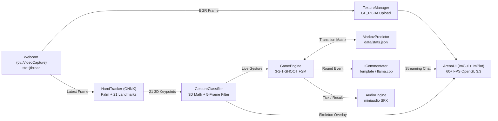

<div align="center">

# RPS Vision

**Real-Time AI Rock-Paper-Scissors Arena in C++23**

[](https://en.cppreference.com/w/cpp/23)
[](https://www.microsoft.com/windows)
[](https://onnxruntime.ai/)
[](https://github.com/ggml-org/llama.cpp)
[](https://opencv.org/)
[](LICENSE)

[Русская версия](README_RU.md)

</div>

---

**RPS Vision** is a standalone, zero-cloud Windows desktop application where you play Rock-Paper-Scissors against an adaptive AI opponent directly through your webcam. It combines **three local AI systems** inside a single native C++23 binary: two-stage ONNX neural hand tracking, a 2nd-order Markov Chain strategist, and an embedded `llama.cpp` commentator.

---

## Key Highlights

- **Sub-5ms Local Hand Tracking:** Two-stage MediaPipe ONNX pipeline (`palm_detection.onnx` + `hand_landmark.onnx`) extracts 21 3D hand keypoints `(x, y, z)` on a dedicated background thread, keeping the OpenGL UI locked at 60+ FPS.
- **3D Geometric Gesture Classifier:** Evaluates 3D finger joint angles and wrist-to-tip reach ratios with a 5-frame temporal smoothing window to eliminate jitter (`Rock`, `Paper`, `Scissors`, `Unknown`).
- **Adaptive Markov-2 Game AI:** Learns your round-to-round habits via a `(prev_player, prev_ai) -> next_player` transition matrix persisted in `data/stats.json`.
- **Anti-Cheat Capture Window:** Validates hand presence at `SHOOT!` — hiding or faking a gesture marks the round as `INVALID`.
- **Hybrid Local Commentator (EN / RU):** Instant offline finite-state commentator (`TemplateCommentator`) or embedded `llama.cpp` GGUF streaming commentary (`LlamaCommentator`) running asynchronously on `std::jthread`.
- **DPI-Aware Fullscreen Desktop UI:** Launches in borderless fullscreen (`F11` to toggle windowed) with Dear ImGui, live `ImPlot` win-rate progression charts, scrollable round history, and low-latency `miniaudio` sound effects.

---

## System Architecture



---

## AI Modes & Game Mechanics

| Mode | Strategy | Behavior |
| :--- | :--- | :--- |
| **Casual (RNG)** | Uniform Random | Pure 1/3 random selection; great for warm-ups. |
| **Tactician (Markov-2)** | 2nd-Order Markov Chain | Tracks `(prev_player, prev_ai) -> next_player` frequencies and counters your most likely habit. |
| **Unbeatable (Cheater)** | Frame-Accurate Peek | Easter egg mode: reads your live gesture at the exact capture frame and counters it while taunting you in chat. |

---

## Tech Stack

| Component | Technology & Version | Role |
| :--- | :--- | :--- |
| **Language** | C++23 (`std::expected`, `std::jthread`, `std::format`) | Core systems & concurrency |
| **Compiler / Build** | MSVC 19.51 (VS 2026) / CMake 3.30+ / vcpkg | Windows x64 standalone build |
| **Computer Vision** | OpenCV 4.14.0 + ONNX Runtime 1.20.1 | Webcam I/O, affine ROI warp, neural inference |
| **Local LLM** | `llama.cpp` 1.0.0 (`ggml` 1.0.0) | Embedded `.gguf` commentary generation |
| **UI & Plotting** | Dear ImGui 1.93.0 (Docking) + GLFW 3.5.1 + ImPlot 1.1 | OpenGL 3.3 HUD & real-time win-rate chart |
| **Audio & Storage** | `miniaudio` 0.11.26 + `nlohmann-json` 3.12.0 | Procedural/WAV SFX & JSON persistence |

---

## Build & Run (Windows x64)

### 1. Prerequisites
- **Visual Studio 2022 / 2026** (Desktop development with C++ & bundled `vcpkg`)
- **Git** and **PowerShell**

### 2. Clone & Install Dependencies
```powershell
git clone https://github.com/yug33n/RPS-Vision.git
cd RPS-Vision
```

Install vcpkg dependencies:
```powershell
& "D:\Visual Studio\VC\vcpkg\vcpkg.exe" install --triplet=x64-windows
```

Download prebuilt **ONNX Runtime** (NuGet) into `third_party/onnxruntime`:
```powershell
New-Item -ItemType Directory -Force -Path third_party/onnxruntime | Out-Null
Invoke-WebRequest -Uri "https://api.nuget.org/v3-flatcontainer/microsoft.ml.onnxruntime/1.20.1/microsoft.ml.onnxruntime.1.20.1.nupkg" -OutFile "third_party/ort.zip"
Expand-Archive -Path "third_party/ort.zip" -DestinationPath "third_party/onnxruntime" -Force
Remove-Item "third_party/ort.zip"
```

### 3. Download AI Models
Download the two required MediaPipe ONNX models into `models/` (see [models/README_MODELS.md](models/README_MODELS.md) for optional `.gguf` LLM setup):
```powershell
New-Item -ItemType Directory -Force -Path models | Out-Null
Invoke-WebRequest -Uri "https://huggingface.co/opencv/palm_detection_mediapipe/resolve/main/palm_detection_mediapipe_2023feb.onnx" -OutFile "models/palm_detection.onnx"
Invoke-WebRequest -Uri "https://huggingface.co/opencv/handpose_estimation_mediapipe/resolve/main/handpose_estimation_mediapipe_2023feb.onnx" -OutFile "models/hand_landmark.onnx"
```

### 4. Configure, Build & Launch
```powershell
$cmake = "D:\Visual Studio\Common7\IDE\CommonExtensions\Microsoft\CMake\CMake\bin\cmake.exe"
& $cmake -B build -G "Visual Studio 18 2026" -A x64 -DCMAKE_TOOLCHAIN_FILE="D:/Visual Studio/VC/vcpkg/scripts/buildsystems/vcpkg.cmake"
& $cmake --build build --config Release
.\build\Release\RPS_Vision.exe
```

---

## Project Structure

```text
RPS-Vision/
├── CMakeLists.txt
├── vcpkg.json
├── LICENSE
├── models/
│   └── README_MODELS.md
└── src/
    ├── main.cpp                   # Borderless fullscreen GLFW + ImGui loop
    ├── core/
    │   ├── AppConfig.hpp/.cpp     # JSON settings persistence
    │   └── Logger.hpp             # Thread-safe C++23 logger
    ├── vision/
    │   ├── CameraCapture.hpp/.cpp # Threaded OpenCV webcam capture
    │   ├── HandTracker.hpp/.cpp   # Two-stage ONNX Runtime inference
    │   └── GestureClassifier.hpp/.cpp # 3D vector math + 5-frame smoothing
    ├── game/
    │   ├── GameTypes.hpp          # Enums & round records
    │   ├── MarkovPredictor.hpp/.cpp # 2nd-order Markov transition matrix
    │   └── GameEngine.hpp/.cpp    # 3-2-1-SHOOT state machine & stats
    ├── ai/
    │   ├── ICommentator.hpp       # Commentator strategy interface
    │   ├── TemplateCommentator.hpp/.cpp # EN/RU FSM reaction engine
    │   └── LlamaCommentator.hpp/.cpp    # Async llama.cpp GGUF streaming
    ├── audio/
    │   └── AudioEngine.hpp/.cpp   # miniaudio SFX with procedural fallback
    └── ui/
        ├── Theme.hpp/.cpp         # DPI-aware dark theme & typography
        ├── TextureManager.hpp/.cpp # cv::Mat -> OpenGL GL_RGBA uploader
        └── ArenaUI.hpp/.cpp       # Controls, webcam HUD, chat & ImPlot
```

---

## License

Distributed under the **MIT License**. See [LICENSE](LICENSE) for details.
