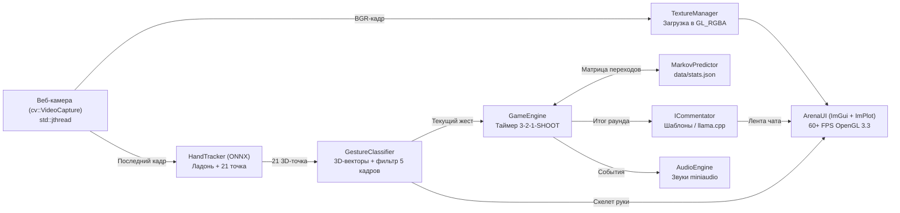

<div align="center">

# RPS Vision

**Камень-Ножницы-Бумага с компьютерным зрением и локальным ИИ на C++23**

[](https://en.cppreference.com/w/cpp/23)
[](https://www.microsoft.com/windows)
[](https://onnxruntime.ai/)
[](https://github.com/ggml-org/llama.cpp)
[](https://opencv.org/)
[](LICENSE)

[English version](README.md)

</div>

---

**RPS Vision** — автономное десктопное приложение для Windows x64, позволяющее играть в «Камень, Ножницы, Бумага» против адаптивного ИИ через обычную веб-камеру. Внутри одного нативного `.exe` без каких-либо облачных API работают **три локальные ИИ-подсистемы**: нейросетевой трекинг ладони на ONNX Runtime, стратег на базе цепей Маркова 2-го порядка и встроенный комментатор на `llama.cpp`.

---

## Ключевые возможности

- **Локальный трекинг руки (<5 мс):** двухэтапный пайплайн MediaPipe ONNX (`palm_detection.onnx` + `hand_landmark.onnx`) извлекает 21 3D-точку `(x, y, z)` в отдельном фоновом потоке, оставляя OpenGL-интерфейс на стабильных 60+ FPS.
- **3D-классификатор жестов:** анализирует 3D-углы суставов и соотношение длин пальцев со сглаживанием по 5 последним кадрам (`Rock`, `Paper`, `Scissors`, `Unknown`).
- **Адаптивный ИИ (цепь Маркова 2-го порядка):** запоминает паттерны игрока через матрицу переходов `(prev_player, prev_ai) -> next_player` с сохранением в `data/stats.json`.
- **Античит-проверка:** контролирует наличие чёткого жеста в момент `SHOOT!` — если убрать руку или показать неясный жест, раунд помечается как `INVALID`.
- **Гибридный комментатор (EN / RU):** мгновенный офлайн-движок (`TemplateCommentator`) или встроенная локальная LLM в формате `.gguf` (`LlamaCommentator` на `llama.cpp v1.0.0`), генерирующая реплики асинхронно на `std::jthread`.
- **Полноэкранный DPI-адаптивный интерфейс:** запуск в Borderless Fullscreen (`F11` для переключения в окно), график винрейта в реальном времени на `ImPlot`, история раундов и звуковые эффекты через `miniaudio`.

---

## Архитектура системы



---

## Режимы игры

| Режим | Алгоритм | Описание |
| :--- | :--- | :--- |
| **Casual (RNG)** | Равномерный случайный выбор | Честный случайный выбор 1 из 3 — идеально для разминки. |
| **Tactician (Markov-2)** | Цепь Маркова 2-го порядка | Отслеживает частоты `(prev_player, prev_ai) -> next_player` и контрит наиболее вероятный следующий ход игрока. |
| **Unbeatable (Cheater)** | Подглядывание на кадре | Пасхалка: считывает жест игрока в момент `SHOOT!` и мгновенно выбирает контр-ход с комментарием в чате. |

---

## Технологический стек

| Компонент | Технология и версия | Назначение |
| :--- | :--- | :--- |
| **Язык** | C++23 (`std::expected`, `std::jthread`, `std::format`) | Ядро, многопоточность и логика |
| **Сборка** | MSVC 19.51 (VS 2026) / CMake 3.30+ / vcpkg | Автономный Windows x64 бинарник |
| **Компьютерное зрение** | OpenCV 4.14.0 + ONNX Runtime 1.20.1 | Захват камеры, аффинный кроп, инференс |
| **Локальная LLM** | `llama.cpp` 1.0.0 (`ggml` 1.0.0) | Встроенная генерация комментариев из `.gguf` |
| **Интерфейс и графики** | Dear ImGui 1.93.0 (Docking) + GLFW 3.5.1 + ImPlot 1.1 | OpenGL 3.3 HUD и график винрейта |
| **Аудио и данные** | `miniaudio` 0.11.26 + `nlohmann-json` 3.12.0 | Звуковые эффекты и сохранение статистики |

---

## Сборка и запуск (Windows x64)

### 1. Требования
- **Visual Studio 2022 / 2026** (разработка на C++ + встроенный `vcpkg`)
- **Git** и **PowerShell**

### 2. Клонирование и зависимости
```powershell
git clone https://github.com/yug33n/RPS-Vision.git
cd RPS-Vision
```

Установите зависимости через `vcpkg`:
```powershell
& "D:\Visual Studio\VC\vcpkg\vcpkg.exe" install --triplet=x64-windows
```

Скачайте готовый **ONNX Runtime** (NuGet) в `third_party/onnxruntime`:
```powershell
New-Item -ItemType Directory -Force -Path third_party/onnxruntime | Out-Null
Invoke-WebRequest -Uri "https://api.nuget.org/v3-flatcontainer/microsoft.ml.onnxruntime/1.20.1/microsoft.ml.onnxruntime.1.20.1.nupkg" -OutFile "third_party/ort.zip"
Expand-Archive -Path "third_party/ort.zip" -DestinationPath "third_party/onnxruntime" -Force
Remove-Item "third_party/ort.zip"
```

### 3. Скачивание моделей
Поместите две обязательные ONNX-модели в `models/` (инструкция по опциональной `.gguf` LLM находится в [models/README_MODELS.md](models/README_MODELS.md)):
```powershell
New-Item -ItemType Directory -Force -Path models | Out-Null
Invoke-WebRequest -Uri "https://huggingface.co/opencv/palm_detection_mediapipe/resolve/main/palm_detection_mediapipe_2023feb.onnx" -OutFile "models/palm_detection.onnx"
Invoke-WebRequest -Uri "https://huggingface.co/opencv/handpose_estimation_mediapipe/resolve/main/handpose_estimation_mediapipe_2023feb.onnx" -OutFile "models/hand_landmark.onnx"
```

### 4. Сборка и запуск
```powershell
$cmake = "D:\Visual Studio\Common7\IDE\CommonExtensions\Microsoft\CMake\CMake\bin\cmake.exe"
& $cmake -B build -G "Visual Studio 18 2026" -A x64 -DCMAKE_TOOLCHAIN_FILE="D:/Visual Studio/VC/vcpkg/scripts/buildsystems/vcpkg.cmake"
& $cmake --build build --config Release
.\build\Release\RPS_Vision.exe
```

---

## Структура проекта

```text
RPS-Vision/
├── CMakeLists.txt
├── vcpkg.json
├── LICENSE
├── models/
│   └── README_MODELS.md
└── src/
    ├── main.cpp                   # Полноэкранный цикл GLFW + ImGui
    ├── core/
    │   ├── AppConfig.hpp/.cpp     # Сохранение настроек в JSON
    │   └── Logger.hpp             # Потокобезопасный C++23 логгер
    ├── vision/
    │   ├── CameraCapture.hpp/.cpp # Потоковый захват камеры OpenCV
    │   ├── HandTracker.hpp/.cpp   # Двухэтапный инференс ONNX Runtime
    │   └── GestureClassifier.hpp/.cpp # 3D-геометрия + фильтр 5 кадров
    ├── game/
    │   ├── GameTypes.hpp          # Типы ходов и результатов раунда
    │   ├── MarkovPredictor.hpp/.cpp # Матрица переходов Маркова 2-го порядка
    │   └── GameEngine.hpp/.cpp    # Логика отсчёта 3-2-1-SHOOT и статистика
    ├── ai/
    │   ├── ICommentator.hpp       # Интерфейс комментатора
    │   ├── TemplateCommentator.hpp/.cpp # Двуязычный FSM-движок (EN/RU)
    │   └── LlamaCommentator.hpp/.cpp    # Асинхронный стриминг llama.cpp
    ├── audio/
    │   └── AudioEngine.hpp/.cpp   # Звуковые эффекты miniaudio
    └── ui/
        ├── Theme.hpp/.cpp         # DPI-адаптивная тема и шрифты
        ├── TextureManager.hpp/.cpp # Загрузка cv::Mat в текстуру GL_RGBA
        └── ArenaUI.hpp/.cpp       # Управление, камера, чат и ImPlot
```

---

## Лицензия

Проект распространяется под лицензией **MIT**. Подробности в файле [LICENSE](LICENSE).
